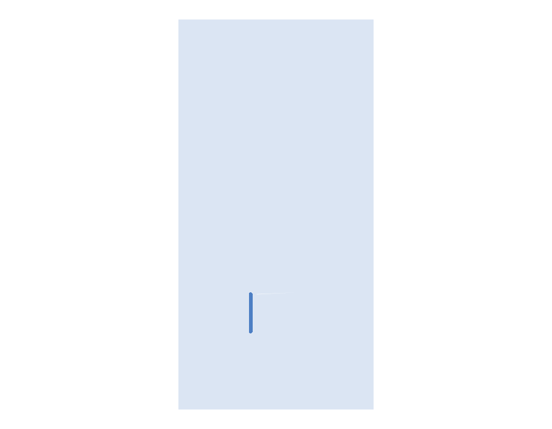
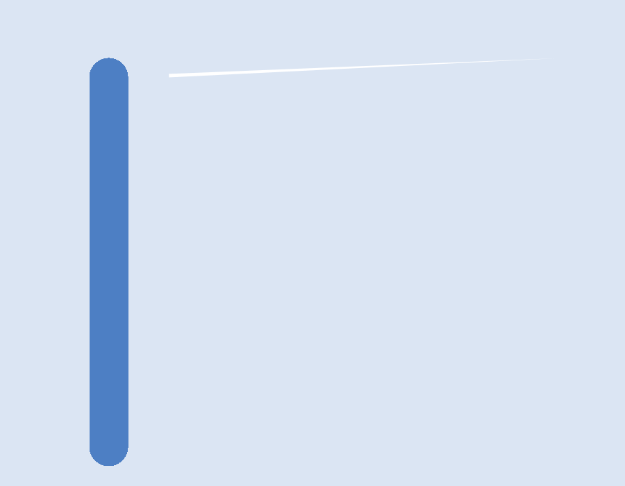

# Connectivity crash on a near-zero pour cutout edge

[Reproduction PR #484](https://github.com/tscircuit/checks/pull/484) reduces a
saved-board failure to one bottom-layer copper pour and one trace. Running
`bun test tests/repros/repro-pour-near-zero-edge.test.ts` produces two visual
snapshots. The reproduction branch records the checker crash with `test.failing`;
this stacked fix turns that assertion into a normal passing test.

## What fails

Two adjacent cutout vertices have the same x coordinate and y coordinates of
`-7.0489999999999995` and `-7.048999999999997` mm. Their separation is about
`2.7e-15` mm. The trace endpoint's horizontal containment ray passes through this
edge. Flatten treats the edge as zero length and throws `Zero division` while
normalizing its direction, so the connectivity check aborts before returning.
The cutout itself has nonzero area; deleting the hole or ignoring the exception
would not be a valid fix.

## Visual evidence

The overview shows the original pour and trace; the close-up uses the renderer's
X-Ray option to reveal the trace next to the narrow cutout. These snapshots show
the geometry, not a visible gap of a few femtometres. The numeric test records the
failure that cannot be resolved visually at that scale. Snapshot assertions run
outside `test.failing`, so a snapshot mismatch remains a test failure.

## Source limitation

This is a saved-geometry reduction, not a native TSX reproduction. Genuine TSX
controls using current core/pour and historical core `0.0.1400` with pour
`0.0.35` render without errors and do not reproduce the crash. Both pour
versions round generated vertices to 1 micrometre, removing the tiny edge.
No generated Circuit JSON was modified to claim a successful TSX reproduction.
PR #484 remains draft because the requested native TSX reproduction is missing.

The independent [Flatten fix](https://github.com/alexbol99/flatten-js/pull/257)
is in another repository. A checks-local fix can be stacked directly on #484
without changing or waiting for that dependency. It must preserve holes, curved
boundaries, layer-aware connectivity and real short/open findings.

## Checks-local fix

The contact tester rebuilds polygons with edges that Flatten considers zero
length omitted. This uses Flatten's numeric zero predicate after the existing
coordinate scaling, not the PCB contact-clearance tolerance. Nonzero edges,
curved shapes and each face's winding remain; holes are not discarded. The
original input polygon is not mutated, and exceptions are not swallowed.
No dependency update or unpublished Flatten build is required.
